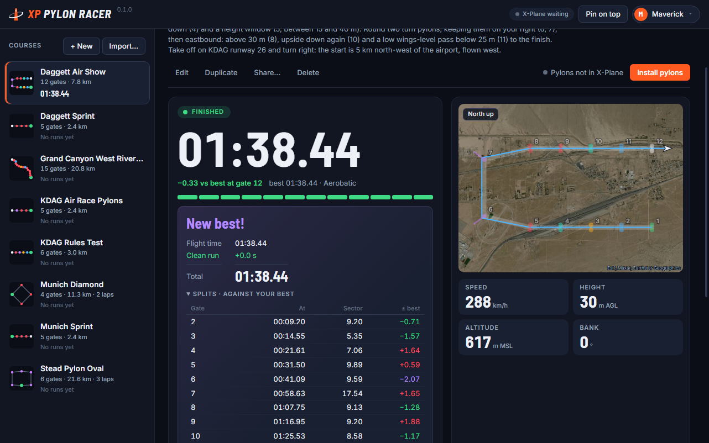
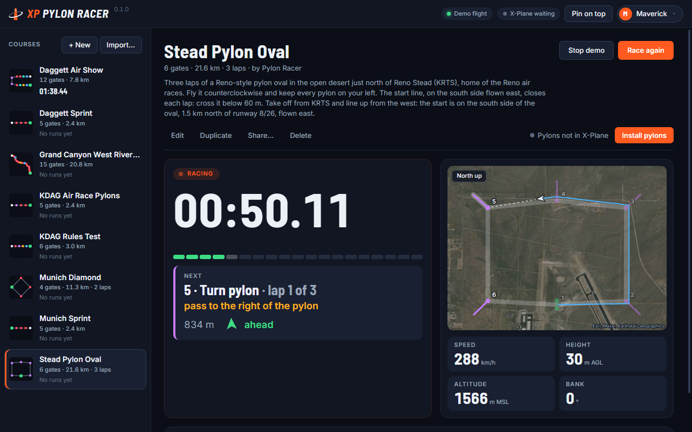
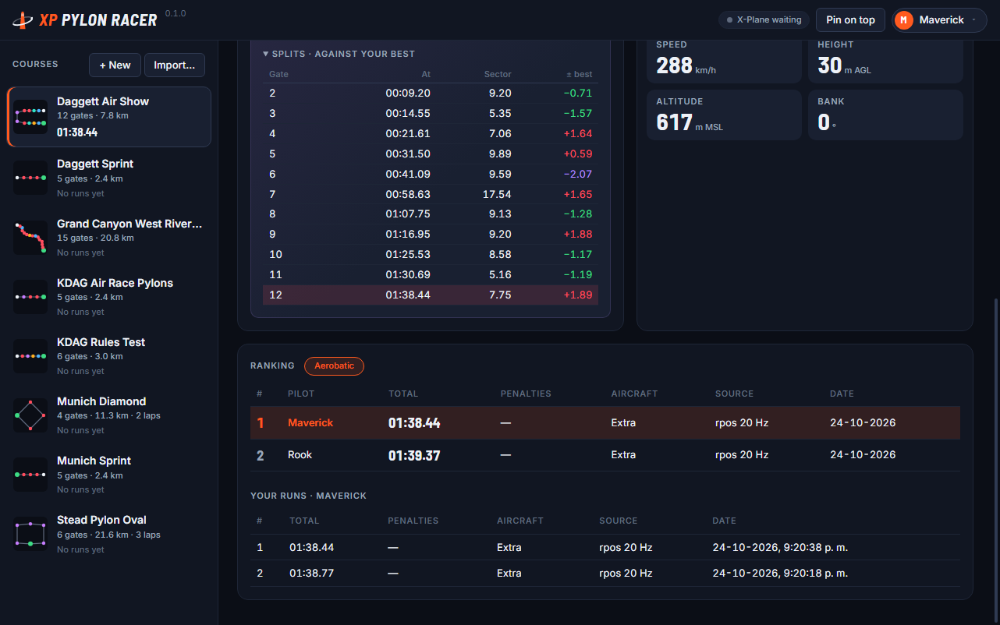
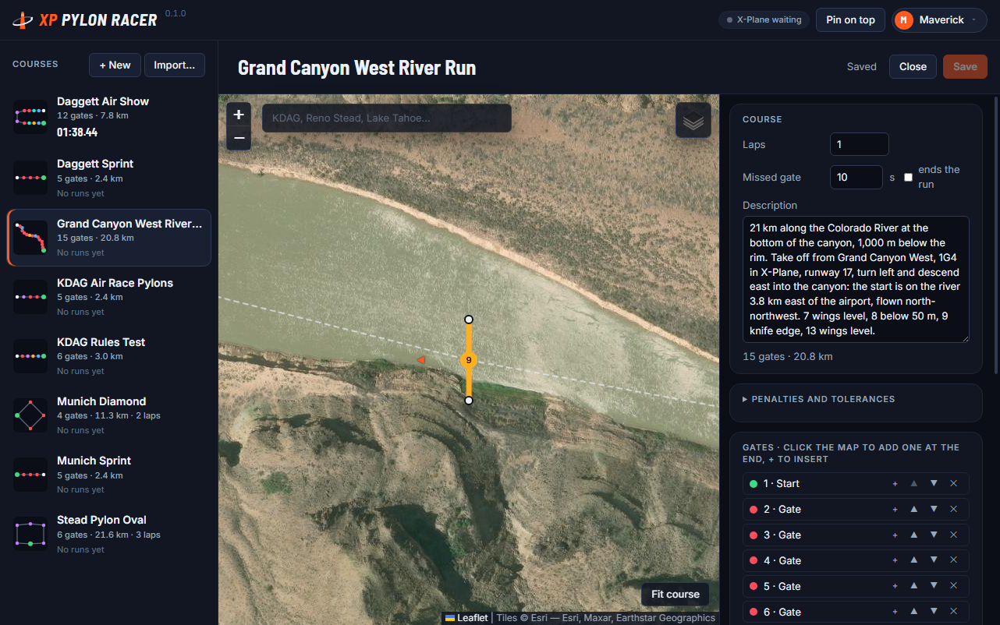

<p align="center"></p>

# XP Pylon Racer

Pylon racing for **X-Plane 12**. Pick a course, fly through its gates in order and race the clock:
XP Pylon Racer follows your flight live, times every gate, applies the rules and keeps your runs.
Design your own courses on a satellite map, install their pylons in X-Plane with one click, and
share them with other pilots as a file.

It is the X-Plane sibling of [Pylon Racer](https://github.com/jlgabriel/afs4-pylon-racer) for
Aerofly FS 4: same races, same rules, same `.pylonrace` course files.



## Install

Grab the latest build from [**Releases**](https://github.com/jlgabriel/xp12-pylon-racer/releases):

| System | File |
|--------|------|
| Windows | `xp12-pylon-racer-<version>-setup.exe` (installer) or `-portable.exe` |
| macOS (Apple silicon / Intel) | `xp12-pylon-racer-<version>-arm64.dmg` / `-x64.dmg` |
| Linux | `xp12-pylon-racer-<version>.AppImage` |
| In-sim display (optional, every system) | `xp12-pylon-racer-plugin-<version>.zip`: see [The race inside X-Plane](#the-race-inside-x-plane) |

Needs **X-Plane 12** (12.1.1 or later to read the aircraft type). The builds are not signed with a
paid certificate:

- **Windows**: if SmartScreen appears, click *More info* → *Run anyway*.
- **macOS**: the first time, macOS says it could not verify the app. Open *System Settings* →
  *Privacy & Security* and click *Open Anyway*.
- **Linux**: make the AppImage executable (`chmod +x`) and run it.

## Get started

1. **[Install](#install) XP Pylon Racer** and start it. It finds X-Plane 12 by itself (from Laminar's own list of
   installations) and shows the folder it uses under each course (**X-Plane**). If you have several
   X-Planes and that is not the one you fly, or it finds none, click **Change…** and choose the folder
   that contains `Custom Scenery`.
2. **Pick a course** on the left and click **Install pylons**. X-Plane reads scenery when it starts,
   so start it (or restart it) after installing.
3. **Fly.** The course's description says where to take off. Nothing needs switching on in X-Plane:
   the app asks it for your position (see [Connecting to X-Plane 12](#connecting-to-x-plane-12)). The
   race arms itself and starts when you fly through the start gate in the right direction. A checklist
   under the timer says what is still missing and where the start is.
4. **Fly the gates in order.** Your run is saved at the finish. **Race again** arms a new attempt.

Want to see it first? **Watch demo** flies any course for you, no simulator needed.

## Courses included

| Course | Where | What it asks |
|--------|-------|--------------|
| **Grand Canyon West River Run** | Grand Canyon West, **1G4** | 21 km along the Colorado River, 1,000 m below the rim, by Jugac64 |
| **Queenstown Lake Race** | Queenstown, **NZQN** | 11 km over Lake Wakatipu with tall pylons, designed by ChatGPT |
| **Pucón Volcano Race** | Pucón, **SCPC** | 15 km over Lake Villarrica below the volcano, a turn pylon and a knife edge |
| **Uyuni Salt Flats Speed Challenge** | Uyuni, **SLUY** | Three laps of an oval on the salt flat, 3,654 m up |
| **Monument Valley Challenge** | Monument Valley, **UT25** | 16 km on the valley floor past the buttes |
| **Rapa Nui Coastal Race** | Easter Island, **SCIP** | 15.5 km on the sea round the cliffs of Rano Kau |
| **Puerto Varas Lake Oval** | Puerto Montt, **SCTE** | Two easy laps on Lake Llanquihue, every pylon on your left |
| **General Carrera Lake Race** | Chile Chico, **SCCC** | 15 km on the turquoise lake, a turn pylon and two wings-level gates |
| **Heimaey Volcano Island Race** | Westman Islands, **BIVM** | 17 km on the sea round the south of the volcanic island |
| **Kauai Coast Challenge** | Līhuʻe, **PHLI** | 15.7 km off the east coast of Kauaʻi to Hoary Head |
| **Lake Tahoe Emerald Run** | South Lake Tahoe, **KTVL** | 15 km on the lake toward Emerald Bay, with a knife edge |
| **Osorno Spiral Ascent** | Puerto Montt, **SCTE** | Two turns round the volcano, from 950 m up to the summit at 2,660 m |
| **Quebrada de las Conchas Run** | Cafayate, **SA02** | 14 km up the red canyon, eight turn pylons on the bends |
| **San Rafael Desert Run** | Hanksville, **KHVE** | 16 km on the desert below the San Rafael Reef |
| **Swaledale Valley Sprint** | RAF Leeming, **EGXE** | 13 km up a Yorkshire Dales valley, with a height window |
| **Auvergne Volcano Circuit** | Clermont-Ferrand, **LFLC** | 12 km through the clearings between the wooded volcanoes |
| **Bardenas Badlands Race** | Ablitas, **XLE001L** | 12 km over the white badlands, a knife edge at the start |
| **Gorafe Ravine Run** | Granada, **LEGR** | 15 km down from the plateau through winding ravines |
| **Cappadocia Ridge Challenge** | Nevşehir Kapadokya, **LTAZ** | 14 km of valleys and a 230 m climb onto the ridge |
| **Flinders Valley Run** | Rawnsley Park, **YRYK** | 15 km up an outback valley and back, a 136° turnaround |
| **Lindis Pass Traverse** | Wanaka, **NZWF** | 13 km over the pass, between valley walls |
| **Namib Dune Run** | Sesriem, **FYSS** | 15 km past the red dunes of Elim |
| **Orkhon Steppe Circuit** | Kharkhorin, **ZMHH** | Two laps on the flat steppe at 1,440 m, every pylon on your left |
| **Abu Dhabi 2014 — Training** | Abu Dhabi, **OMAD** | The 2014 air race off the Corniche: slalom and wings-level gates at 15–25 m |
| **Chiba 2019 — Training** | Tokyo Bay, **RJTT** | The 2019 air race off Makuhari Beach, 1.6 km at 15–25 m |
| **Porto 2017 — Training** | Porto, **LPPR** | The 2017 air race up the Douro, between the bridges |
| **Reno Sport 2023 — Training** | Reno Stead, **KRTS** | Two laps of the Sport class course, 15–76 m at every pylon |
| **Aysén Fjord Speed Run** | Puerto Aysén, **SCAS** | 19 km of long, fast legs over the fjord, between wooded islands |
| **Badwater Basin Precision Oval** | Furnace Creek, **L06** | Two laps on the salt flats of Death Valley, 82 m below sea level |
| **Cochamó Granite Valley Run** | Cochamó, **SCKM** | 15 km up a granite valley, from the estuary to La Junta at 320 m |
| **Daggett Precision Cup** | Daggett, **KDAG** | Two laps of a tight circuit, two wings-level and two knife-edge gates a lap |
| **Futaleufú River Chase** | Futaleufú, **SCFT** | 15 km down the river round its bends, 26 gates |
| **Geiranger Fjord Challenge** | Stryn, **XEN000I** | 15 km round the S-bend of the Geirangerfjord to the village |
| **Glen Coe Highland Descent** | Oban, **EGEO** | 13 km down the glen, from 280 m to the shore of Loch Leven |
| **Kornati Island Slalom** | Zadar, **LDZD** | 17 km on the sea among the outer Kornati islands |
| **Milford Sound Fjord Run** | Milford Sound, **NZMF** | 15.5 km down the fiord to the Tasman Sea, with a slalom at the end |
| **Stead Right-Hand Sprint** | Reno Stead, **KRTS** | Three laps of a small oval, every pylon on your right |
| **Stead Pylon Oval** | Reno Stead, **KRTS** | Three laps of a Reno-style oval, every pylon on your left |
| **Daggett Air Show** | Daggett, **KDAG** | Wings level, knife edge, inverted, a height window and turn pylons |
| **Daggett Sprint** | Daggett, **KDAG** | Five gates in a straight line: the quickest way to learn |
| **KDAG Rules Test** | Daggett, **KDAG** | One gate of each classic kind |
| **KDAG Air Race Pylons** | Daggett, **KDAG** | The 15, 18 and 25 m air-race pylons |
| **Munich Sprint** / **Munich Diamond** | Munich, **EDDM** | A straight sprint, and two laps of a diamond |

## Racing



- **Live race screen**: race time, the delta to your best at each gate, the gate strip, the next gate
  with what it asks for and which way to turn ("35° left"), a course map over satellite imagery with
  your trail, and speed, height, altitude and bank.
- **Splits**: the result shows the time between every two gates against the same stretch of your best.
- **Multi-lap courses**: the start line closes each lap; lap times are shown at the finish.
- **Gate detection that does not depend on the update rate**: a pass is found by crossing the gate line
  between two samples, and its instant is interpolated.
- **Height rules use X-Plane's own height above the ground**, so a ceiling or a floor is judged
  against the terrain you actually see.
- **Demo flights** never count for the ranking.

### Flying with one monitor

Install the [in-sim display](#the-race-inside-x-plane) and the race shows inside X-Plane. Or use
**Pin on top**, which keeps the app above the simulator (run X-Plane windowed). Make the window
narrow and it shows only what you need while flying: the timer, the next gate with its turn arrow,
the map and the values.

### The race inside X-Plane

An optional X-Plane plugin shows the race in a window inside the sim: the race status, a big
clock, the next gate with what it asks and an arrow pointing the way to it, and the course map. At
the finish the clock says how it went: **New best!**, your time against your best, or why the run
did not finish. The window can be moved and resized, popped out onto another monitor or moved into
VR, and it comes back where you left it.

The plugin only shows: the app still times and judges the race, so keep it running with the course
open. To install it:

1. Download `xp12-pylon-racer-plugin-<version>.zip` from
   [Releases](https://github.com/jlgabriel/xp12-pylon-racer/releases). One zip holds Windows, macOS
   and Linux.
2. With X-Plane closed, copy its `XPPylonRacer` folder into `X-Plane 12/Resources/plugins/`.
3. **macOS**: macOS blocks plugins downloaded from the internet. In Terminal, run
   `xattr -dr com.apple.quarantine "<your X-Plane 12>/Resources/plugins/XPPylonRacer"`.
4. Start X-Plane and the app, and open a course. The window appears by itself, and the list before
   the start says **In the sim**.

**Plugins › XP Pylon Racer** shows or hides it, pops it out and moves it into VR. To show and hide it
with a key or a joystick button, assign `xpr/toggle_display` in *Settings › Keyboard*. The window
stays hidden until the app first speaks to it, so with the app closed the plugin shows nothing. To
uninstall, delete the `XPPylonRacer` folder with X-Plane closed.

### The rules

| Gate | How to pass it |
|------|----------------|
| **Start** / **Finish** | Between the pylons, in the course's direction. The start starts the clock |
| **Gate** | Between the pylons, in the course's direction |
| **Level gate** | With the wings level (±10° of bank) |
| **Knife-edge gate** | On a wing (90° of bank, ±15°) |
| **Inverted gate** | Upside down (180° of bank, ±20°) |
| **Turn pylon** | A single pylon: fly around it on the side the course says |

Any gate can also have a **ceiling**, a **floor**, or both (a height window), measured above the ground.

| Penalty | Default |
|---------|---------|
| Missed gate | +10 s (or the run ends, if the course says so) |
| Wrong direction | +10 s |
| Wrong attitude (level, knife edge, inverted) | +2 s |
| Too high / too low | +2 s |
| Pylon hit (closer than 5 m, below its top) | +3 s |
| Turn pylon cut | +10 s |

Every course can change its penalties and tolerances.

## The pylons

XP Pylon Racer draws its own pylons: tapered, striped tubes generated when you install a course, in
ten colours and heights from 15 to 25 m. Each gate can use any of them. Because the app makes them,
it knows exactly how tall and how wide every pylon is, which is what the pylon-hit rule needs.

Pylons are hard to spot from a distance in a simulator, so every course also picks a **pylon size**:
**Standard**, or **Tall ×2**, every pylon twice as tall and twice as wide (30 to 50 m). The pylon-hit
distance grows with the pylon, and a Tall course has its own ranking, since times around bigger
pylons do not compare.

Installing a course writes one scenery pack, `Custom Scenery/XPR_<course>/`, and one line in
`scenery_packs.ini`, just below `*GLOBAL_AIRPORTS*` (the file is backed up first, and nothing else in
it is touched). **Remove** takes both out again. The app never touches a folder it did not create.

## Pilots and rankings



- **Ranking per course and aircraft class** (aerobatic, vintage and warbird, general aviation, jet,
  helicopter, glider, heavy), one row per pilot with their best run.
- The app reads your aircraft's ICAO type code from X-Plane (C172, Extra, P51…) and knows the class of
  the X-Plane 12 fleet and many popular add-ons. For any other aircraft, pick the class in the top
  bar once; it is remembered.
- **Several pilots on one computer**: click the callsign in the top bar to switch, add or remove.
- **Changing a course's gates or rules starts a new ranking** for it.

## Design your own courses



- **Course designer on a satellite map**: search for an airport or a place, click to place gates, drag
  a gate to move it, drag its arrow to turn it, drag a pylon to make it wider or narrower.
- **Gate kinds**, **laps**, **height limits**, the **pylon** of each gate, the **pylon size** and the
  course's **penalties and tolerances**.

## Sharing

There is no server: courses travel as files. Your runs stay on your computer.

- **Share…** on a course saves a `.pylonrace` file. To open one, use **Import…**, drop it on the
  window, or double-click it.
- **Courses made in Pylon Racer for Aerofly FS 4 open here, and the other way round.** A course keeps
  its gates and its look; its rankings are separate in each app, since times from two simulators do
  not compare. Pylon Racer has no Tall pylons: a Tall course opens there with Standard ones.
- With both apps installed, double-clicking a `.pylonrace` opens the one installed last. **Import…**
  works in either.

### Shirley calls your race

**Export to Shirley…** turns a course into a challenge for [FlyShirley](https://airplane.team),
the AI copilot, so she commentates your run like an air race broadcast: a course preview on the way
to the start, live call-outs gate by gate, and a verdict at the end. The app saves a `.json` file and
copies it to the clipboard: paste it into Shirley's Challenge Creator
([airplane.team/fly/create](https://airplane.team/fly/create)). The challenge carries the gates, the
rules and your records on that course. Keep XP Pylon Racer open on the same course while you fly: it
still times and scores the race, and Shirley only watches.

Every gate has a wake-up trigger, so Shirley calls it the instant you reach it ("Gate 3! Knife edge
next."). A turn pylon's pass line, from the pylon out to the side you fly, is lined with small
invisible gates that only Shirley knows about, so she calls "Pylon 4!" wherever you cross it. A
multi-lap course becomes one race phase per lap, and Shirley moves through them on her own.

## Connecting to X-Plane 12

There is nothing to install in X-Plane (the [in-sim display](#the-race-inside-x-plane) is
optional) and nothing to switch on:

- **Position (RPOS, UDP port 49000).** The app asks X-Plane for its position (it arrives about 30
  times a second), the way moving maps do (documented in X-Plane's `Instructions/Exchanging Data with X-Plane`). It asks
  again whenever the stream stops, so X-Plane can be started before or after the app.
- **Aircraft and replay (Web API, port 8086, X-Plane 12.1.1 or later).** To read which aircraft you
  fly, and whether X-Plane is playing a replay: positions from a replay are not raced.

Both are local to your computer. If **Settings › Network › Disable Incoming Traffic** is ticked in
X-Plane, untick it. The top bar shows whether X-Plane is sending and at what rate.

**X-Plane sends RPOS to one program only**, the last one that asked. If another program on this
computer also asks for it (some moving maps do), the two keep taking it from each other: the top bar
then says *RPOS taken*. Close the other program, or switch it to another X-Plane output; the app
takes RPOS back on its own within about 10 seconds.

## Building from source

Requires Node 24.

```bash
npm install
npm run dev            # run the app
npm run typecheck      # both tsconfigs
npm test               # unit tests
npm run test:e2e       # builds, then drives the Electron app
npm run build:win      # or build:mac / build:linux
```

`npm run preview:renderer` serves the interface alone in a browser (port 5298); open it with
`?mockracer` to race demo flights without Electron. `npm run plugin` builds the in-sim display
plugin (C++, CMake; it downloads the X-Plane SDK 4.3.0 from Laminar the first time) into
`plugin/out/XPPylonRacer/` and tests it against the app's messages. The `probe:*` scripts are the simulator checks
described in [`probes/README.md`](probes/README.md).

## License and credits

GPL-3.0-or-later. See [LICENSE](LICENSE).

XP Pylon Racer ships no X-Plane content and no third-party models: the pylons are generated by the
app. The plugin is built with Laminar Research's X-Plane SDK. The fonts are Inter and Barlow Semi Condensed (SIL Open Font License). See
[THIRD_PARTY_NOTICES.md](THIRD_PARTY_NOTICES.md).
